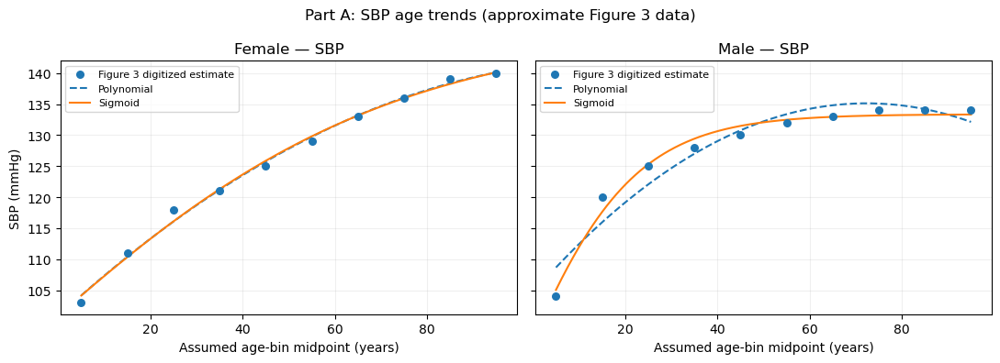
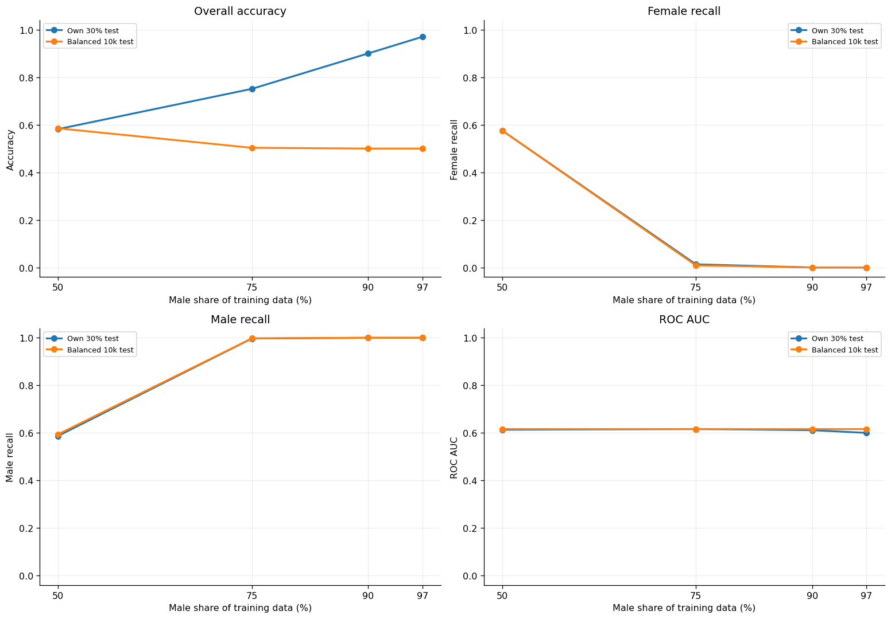
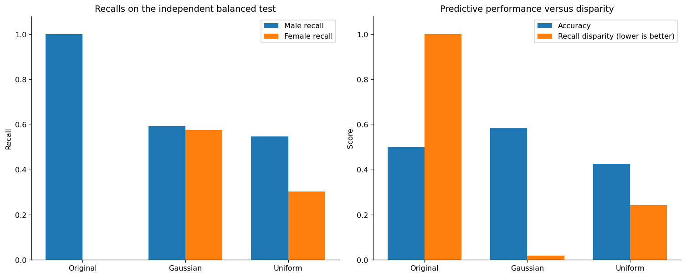

# BMI 500 — HW3: Blood Pressure Bias

**Student:** Suyang Xi | **Email:** sxi5@emory.edu

In **Part A**, I fitted age-related blood pressure trends. A quadratic model worked best for most comparisons, while a sigmoid worked better for male SBP.

In **Part B**, the model trained with 97% male data reached 97% accuracy on its own imbalanced test set but missed every female. On the balanced test set, Gaussian female augmentation improved accuracy from 50.0% to 58.46% and reduced the male–female recall gap to 1.92%. Uniform augmentation worked worse. My hypothesis about class imbalance was supported, while the model-fitting hypothesis was only partly supported.

**Results figures:**

**Run:** Install dependencies with `pip install -r requirements.txt`, then run `partA_model_fitting_ALL_IN_ONE.ipynb` and `partB_bias_analysis_ALL_IN_ONE.ipynb`. The plots and detailed results are in the notebooks.

**AI statement:** Statement: ChatGPT was used to complete this homework, including help extracting approximate blood pressure values from the paper's figure. The full chat is available at: <https://chatgpt.com/share/6ad02815-0a54-83ea-975f-9f0f61c7ac5c>.
